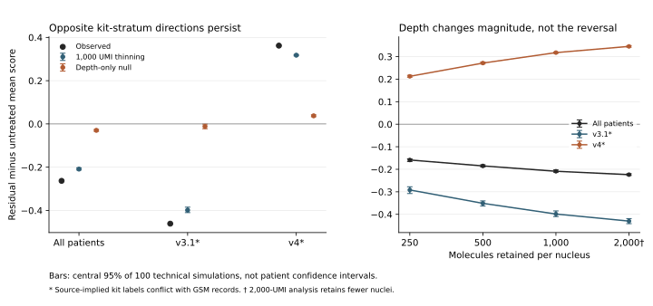

# Testing whether sequencing depth explains the signature reversal

**Equal-depth thinning does not remove the observed kit-stratum reversal.** After reducing every included nucleus to exactly 1,000 observed molecules, the residual-minus-untreated mean score remains negative in the source-implied v3.1 group and positive in v4. The direction also reverses in the untransformed signature transcript fraction. Depth standardization is insufficient under this observed-molecule intervention; other depth/capture models remain unresolved. This does not establish biological causation or a new resistance mechanism.

The cohort contains 26 untreated and nine residual-disease LUAD patients, represented by 121,083 deposited malignant singlet nuclei. Patients receive equal weight. The exact published Maynard 17-gene score, cohort eligibility and patient assignments are inherited from the [earlier comparison](../../results/gse292469-alveolar-2026-11-10/RESULTS.md). MRD2 is one patient with two libraries and remains in the pooled analysis only.

## Frozen tests

The [plan](../depth-simulation-plan.json) was [locally frozen](../depth-plan-freeze.json) at 18:23:12 UTC on November 10, 2026, after inspecting the earlier mean scores and depth metadata but before inspecting the new outcomes. This is exploratory research, not external preregistration or a blinded analysis.

1. **Equal-depth thinning:** sample exactly 1,000 molecules without replacement from each observed nucleus, including the 17 targets and all other molecules. Recompute `mean(log(1 + 10000 × gene_count / total_count))`, average within patient, then compare patients. Repeat 100 times with a fixed seed. Every primary nucleus is retained.
2. **Depth-only null:** estimate one common 17-gene proportion vector, averaging each patient's mean fractions equally. Simulate joint multinomial counts at the actual nucleus depths. All patients share the same underlying profile. Repeat with a constant depth of 1,000 as a negative control, and with exactly doubled target proportions in residual disease as a positive control.
3. **Other summaries:** retain total signature UMI fraction, detected-gene breadth and all per-gene contributions. Do not select genes based on the result.

## Main results

All contrasts below are residual minus untreated patient means. Intervals are central 95% ranges across **100 technical simulations**, not patient confidence intervals. Their tail quantiles are coarse with only 100 replicates.

| Source-implied group | Untreated / residual patients | Observed score difference | Difference after 1,000-UMI thinning | Technical simulation range | Common-profile depth-only null |
|---|---:|---:|---:|---:|---:|
| Pooled | 26 / 9 | −0.26314 | −0.20886 | −0.21303 to −0.20281 | −0.02965 |
| v3.1 | 24 / 3 | −0.46108 | −0.39865 | −0.40999 to −0.38481 | −0.01126 |
| v4 | 2 / 5 | +0.36201 | +0.31775 | +0.31467 to +0.32044 | +0.03744 |



The common-profile null reproduces the signs but not the observed magnitudes under its restrictive assumptions. It is not a fitted decomposition of the real differences. Dividing its contrast by the observed contrast would **not** estimate a percentage caused by depth.

The fixed-depth common-profile null has exactly zero expected contrast. Its simulated pooled mean was −0.00063. The known twofold target-proportion control gave +0.43795 and rank AUC 1 in every group. This demonstrates computational sensitivity to the injected change, not sensitivity to a real cancer mechanism.

The raw relative abundance contrast also reverses: −0.01029 pooled, −0.01466 in v3.1 and +0.00605 in v4. These are fractions of total UMIs, equivalent to −1.029, −1.466 and +0.605 percentage points. Mean detected-gene breadth contrasts are −1.682, −2.190 and +2.334 genes respectively. Thus the logarithmic transformation alone is not sufficient to account for the reversal.

## Sensitivities and checks

The opposite stratum directions persist at all prespecified thinning depths: 250, 500, 1,000 and 2,000 UMIs. The 2,000-UMI analysis retains 104,477 nuclei and all 35 patients, so it changes nucleus selection. Its corresponding unthinned retained-cell baseline is −0.24981 pooled, −0.45091 in v3.1 and +0.36952 in v4. The result file retains that baseline and each patient's retained count; it should not be compared to the full cohort as if only depth changed.

The implementation checks original source hashes, exact nucleus/patient alignment, integer counts, target membership and reproduction of all previous patient scores. Cached inputs undergo these membership and score checks again. Four synthetic tests cover full-depth identity, hypergeometric expectation, joint multinomial behavior and score calculation.

An [independent computational review](independent-review.md) checked 134 nuclei directly against the source H5, reproduced all 35 patient summaries and evaluated exact distribution expectations separately from the simulation functions. All 12 reviewed mean contrasts agreed within 1.782 Monte Carlo standard errors. The exact expected 1,000-UMI contrasts are −0.209209, −0.399445 and +0.317682. This reviewer check supports the numerical result; it is not external scientific peer review. AUC simulation variance was not independently verified.

## What remains unresolved

Source kit assignments conflict: series-level descriptions imply v3.1 and v4, while sample records repeat v3.1 boilerplate. Labels here are provisional strata, not a verified causal batch variable. Only two untreated patients occupy v4. Stage and tissue site are strongly imbalanced: eight of nine primary residual patients are stage IV, compared with one of 26 untreated patients; that untreated stage-IV specimen is a lymph node, leaving no stage-IV untreated lung comparator.

Thinning conditions on already observed molecules. It cannot recover missed transcripts or remove ambient RNA, gene-specific capture, cell-state composition, sampling-site effects or patient differences. The homogeneous technical null deliberately removes real biological heterogeneity. Rejecting its sufficiency does not select among the remaining explanations.

Depth sensitivity and downsampling are established methods, including a [previous cancer signature benchmark](https://elifesciences.org/articles/71994). The source study's [2025 preprint](https://pmc.ncbi.nlm.nih.gov/articles/PMC12248098/) already reported declining alveolar signatures with disease progression. It used different signatures and processing; this raw-count Maynard17 calculation does not reproduce its corrected UCell assay. The [novelty audit](../novelty-audit.md) found no matching exact kit-stratified thinning analysis in the sources inspected, but cannot establish first-ever novelty.

The useful result is a bounded exclusion: equal-depth sampling of the observed molecules does not remove this dataset's directional inconsistency. Next validation needs authoritative kit assignments, the author-corrected assay and better-balanced or paired specimens. The [joint-expression diagnostic](../coexpression/README.md) separately tests what the mean score says about within-cell coordination.

## Reproduction

Use Python 3.12 and the pinned [treatment dependencies](../../../../requirements-treatment.txt). Acquire the pinned source files under the terms described in the [molecular acquisition manifest](../../updates/2026-11-10/acquisition-manifest.json). Raw H5, cell metadata and the extracted target-count cache remain local; published outputs contain patient aggregates and original analysis code.

From the repository root:

```sh
python -m unittest discover -s tests -p test_signature_depth.py -v
python scripts/simulate_signature_depth.py
python scripts/check_signature_depth.py
python scripts/plot_signature_depth.py research/treatment-discovery/discovery-2026-11-10/depth-simulation
```

These commands regenerate dated results; use a disposable clone to preserve the published bytes. [results.json](results.json) retains all contrasts, source/code hashes, control results and simulation settings. [patient-diagnostics.json](patient-diagnostics.json) retains every patient's per-gene fractions, score contributions and depth/breadth summaries. Seeds and exact dependencies matter for byte-level numerical reproduction.
