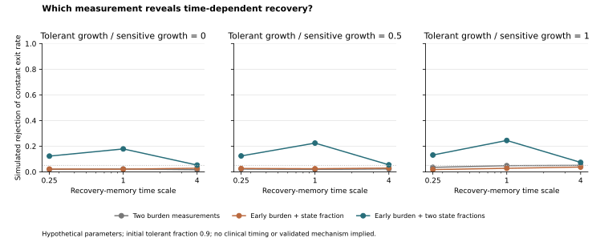

# Recovery-memory simulation: a measurement-design failure

This is a **synthetic experiment-design study**, not a fitted model of patients or a discovered resistance mechanism. Version 1 was fixed before simulation in [protocol.json](protocol.json). Its useful result is negative: the tested sparse measurement plans do not reliably distinguish time-dependent recovery from a constant switching-rate alternative.

## Model and question

After a hypothetical stress is removed, sensitive cells S and tolerant cells P follow:

```text
dS/dt = gS S + b(t) P
dP/dt = [gP - b(t)] P
N = S + P; F = P/N
```

The memoryless null has constant exit rate b. The alternative has `b(t) = b_inf × [1 − exp(−t/tau)]`. Both start with exactly the same total burden and tolerant fraction. Time is measured in hypothetical sensitive-cell doubling times; no conversion to days, drug exposure or clinical dosing is justified. All rates, initial fractions and noise values are deliberately hypothetical. No parameter was estimated from the project's single-cell data, and its 17-gene expression score is **not** assumed to identify functional tolerant cells.

The protocol's motivating question concerns common early observations. Its specified likelihood actually profiles b jointly over whichever observations a design collects. The later time point is **not** withheld from that fit; held-out simulation replicates, rather than time points, test the calibrated procedure.

## Prespecified comparison

We tested 81 combinations of initial fraction, relative tolerant growth, asymptotic exit rate and relaxation time, under four noise settings. Each design uses a common known initial state and growth rates, an idealization:

1. Total burden at times 0.5 and 2.
2. Total burden and tolerant fraction at time 0.5.
3. Total burden at 0.5 plus tolerant fractions at 0.5 and 2.

Burden noise is mean-unbiased lognormal. State measurements are binomial with a specified symmetric label-error probability. The primary setting has 10% burden CV, 200 labeled cells per observation, and 5% label error. Other settings vary these errors. Independent random seeds generate null calibration, held-out null tests and memory alternatives. A worst-grid 95th-percentile threshold is calibrated separately for each design; this finite grid is not proof of uniform false-positive control.

## Version 1 result

| Design | Median detection across 81 primary cases | Maximum detection | Cases reaching 80% detection | Maximum held-out null false positive across all noise settings |
|---|---:|---:|---:|---:|
| Two burden measurements | 3.65% | 5.15% | 0/81 | 5.55% |
| Early burden and one fraction | 3.20% | 5.20% | 0/81 | 5.65% |
| Early burden and two fractions | 4.20% | 77.40% | 0/81 | 5.45% |

These percentages describe simulated replicate experiments under chosen parameters. They are not probabilities that biological memory exists, and the parameter-grid median is not a population prevalence. Each false-positive/power estimate uses 2,000 replicates; Monte Carlo standard errors are included for every case in [results.json](results.json). Designs have different modalities and numbers of readouts, so this is not a cost-normalized optimal-design comparison.

When the memoryless competitor can also change tolerant-cell growth, it matches **both noiseless burden observations in all 81 alternative cases** to numerical tolerance. Thus bulk rebound can fail through structural ambiguity, not only insufficient measurement precision. Independently determining growth and collecting informative state measurements matter more than fitting a more elaborate curve to two counts.



The plotted slice is initial tolerant fraction 0.9 and asymptotic exit rate 0.4 in the primary noise setting. The full grid, including poor-performing and null cases, is retained.

## Controls and limits

The analytic constant-rate solution agrees with numerical integration across 27 control cases within `4.83e-12`. With equal net growth rates, total burden is exactly `exp(gS × t)` regardless of state switching; the numerical check differs by less than `2.86e-10`. Vanishing recovery time approaches the constant-rate model, a zero-tolerant-population control passes, and tighter solver tolerances leave the reported trajectory unchanged within `1.15e-10`.

The main model excludes re-entry into tolerance after stress removal, density dependence, demographic randomness, replicate heterogeneity, mutation and complex microenvironment feedback. Initial fraction, growth rates and label-error rate are known in the simulation. Those assumptions are stronger than real experiments normally support. Rejection of a constant-rate model would identify a mismatch, not its biological cause. Time-dependent growth, marker drift and unobserved states are competing explanations.

## Prior art and next test

Reversible tolerance was experimentally reported long ago in [Sharma et al., 2010](https://pmc.ncbi.nlm.nih.gov/articles/PMC2851638/). Memory and phenotypic inheritance were modeled by [Cassidy et al., 2021](https://doi.org/10.1371/journal.pcbi.1009348). Counts-versus-fractions identifiability and experiment design are established in [Gunnarsson, Foo and Leder, 2023](https://pmc.ncbi.nlm.nih.gov/articles/PMC10372878/). More recent [stress-memory modeling](https://pmc.ncbi.nlm.nih.gov/articles/PMC12673137/) and a [2026 drug-induced switching preprint](https://arxiv.org/abs/2611.00295) further exclude a broad novelty claim. These sources motivate structures, not numerical parameter values here.

The exact project stress test is an original implementation, but its scientific novelty is **unestablished**. Its immediate use is to reject weak measurement plans before collecting data. A separately frozen [version 2](v2/README.md) tests absolute-state abundance curvature, with analytic power and explicit alternative explanations. Version 1 is preserved rather than tuned until it produces a favorable result.

## Reproduce

With Python 3.12 and the project's `requirements-treatment.txt`:

```sh
python scripts/simulate_egfr_state_dynamics.py --out tmp/recovery-memory-reproduction
```

The [script](../../../../scripts/simulate_egfr_state_dynamics.py) checks the frozen protocol hash, runs its controls, preserves all calibrated and held-out cases, and generates the figure. Raw patient data and external downloads are not required.
