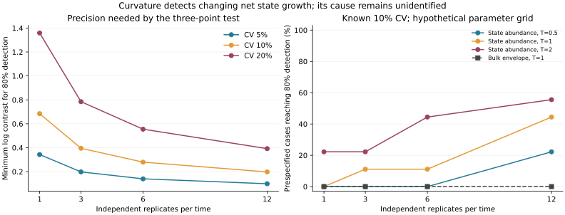

# Three abundance measurements: a precision rule and its failure boundary

**Useful result:** three equally spaced measurements of the absolute abundance of a defined cell state can test whether its net growth rate changes over time, without knowing its initial abundance or constant growth rate. The test needs substantial precision: with known 10% measurement CV, three independent replicates at each time detect a log-curvature contrast of at least **0.395** with 80% power; twelve replicates reduce this to **0.198**. A changing marker or changing proliferation rate produces the same signal, so this is **not a test that specifically identifies biological memory**.

This synthetic follow-up was frozen in [protocol.json](protocol.json) before its first run. [Version 1](../README.md) remains unchanged and documents weak sparse-measurement designs. Neither version uses patient data or estimates a clinical treatment effect. All numerical parameters are hypothetical.

## The contrast and what it cancels

After hypothetical stress removal, tolerant cells P leave their state for sensitive cells S:

```text
S' = gS*S + b(t)*P
P' = [gP - b(t)]*P
N = S + P
```

The constant-rate null sets `b(t)=b`. The illustrative recovery alternative sets `b(t)=b_inf*(1-exp(-t/tau))`. The model omits re-entry, density dependence, mutation and between-replicate biological heterogeneity. P denotes a functionally defined state; the project's 17-gene expression score is not assumed to be a validated tolerance label. Time is in hypothetical sensitive-cell doubling times, **not days or doses**.

For measurements at 0, T and 2T, define:

```text
C = 2*log P(T) - log P(0) - log P(2T)
```

Under constant net growth, log P is a straight line and C=0. Unknown initial abundance, gP and constant b cancel. Under the recovery alternative, integration gives:

```text
log P(t) = log P0 + (gP-b_inf)*t + b_inf*tau*(1-exp(-t/tau))
C = b_inf*tau*(1-exp(-T/tau))^2
```

The contrast is twice the log departure of the middle abundance from the geometric mean of the two endpoints. Thus C=0.395 corresponds to a middle abundance about 22% above that geometric mean. C=0.198 corresponds to about 10% above it. These are effect sizes required by this particular noisy measurement model, not biological thresholds.

## Precision, replicated simulation and comparison

If each abundance measurement has independent mean-unbiased lognormal noise with known CV, write `sigma^2=log(1+CV^2)`. Averaging logs across r independent replicates per time gives:

```text
SD(C_hat) = sqrt(6)*sigma/sqrt(r)
Reject constant net growth if |C_hat| > 1.959964*SD(C_hat).
Power(C) = Phi(-1.959964-C/SD) + 1-Phi(1.959964-C/SD).
Minimum positive C for 80% power = 2.801582*SD(C_hat).
```

The common mean-log noise bias cancels. A known variance is a strong assumption; with only one replicate it would need independent calibration. Merely using a sample variance in this formula does not preserve the stated test.

| Independent replicates at each of 3 times | Minimum C, CV 5% | Minimum C, CV 10% | Minimum C, CV 20% |
|---:|---:|---:|---:|
| 1 | 0.343 | 0.685 | 1.359 |
| 3 | 0.198 | 0.395 | 0.785 |
| 6 | 0.140 | 0.279 | 0.555 |
| 12 | 0.099 | 0.198 | 0.392 |

We evaluated 81 parameter combinations, three fixed observation spacings, three noise levels and four replicate counts: **2,916 settings**, with 5,000 simulated experiments each. None of the final test cases selected the time windows or thresholds. State-abundance power reaches 80% in 621 settings. The median across this deliberately chosen grid is only 13.87%, and many settings have approximately null-level detection. The grid is not a biological population distribution; nine combinations of initial fraction and constant growth share each state-contrast effect size.

For a fixed central example, `b_inf=0.5`, `tau=0.8`, `T=1`, the expected contrast is 0.204. With 10% CV, analytic power is 30.3% for three replicates per time, 53.2% for six and 82.3% for twelve. The parameter values are illustrations, not measured EGFR biology.

The bulk-count comparator uses the same three times and replicate counts. Because changing state composition curves log N even with constant rates, testing bulk C=0 would be an invalid null. Instead, a conservative envelope covers 57,477 constant-rate combinations with unknown composition and growth. It reaches 80% power in **0/2,916 settings**; median simulated detection is 1.40%, and the maximum is 4.42%. This is a comparison with one conservative bulk procedure, **not proof that every bulk method fails**. For example, [Wu et al., 2025](https://www.nature.com/articles/s41540-025-00560-8) infer therapy-induced plasticity from bulk counts under a richer branching-process model with dose-response and delayed-effect assumptions. Equal measurement counts and assumed CV do not imply equal real assay cost or attainable precision.



For fixed b_inf and T, the signal is largest at `tau/T=0.795905`, where `C/(b_inf*T)=0.407264`. This follows by differentiating `(1-exp(-x))^2/x`, with `x=T/tau`, and solving `exp(x)=2*x+1`. Both very fast and very slow recovery produce weak curvature over a fixed observation window. This is a sensitivity identity, not a recommendation about drug administration.

## False positives and a useful warning

Independent null tests used 64 off-grid parameter combinations across all 36 observation/noise/replicate settings. Across these 2,304 settings, state-test false-positive rates have median **4.98%** and range **4.02–6.12%**, compared with exact theoretical 5%. Each estimate uses 5,000 experiments; the standard error near 5% is about 0.31 percentage points. The largest rate is selected from thousands of estimates, not a single prespecified null experiment. No off-grid null trajectory fell outside the bulk calibration envelope; that finite check does not establish a continuous-parameter guarantee. All case rates and their Monte Carlo standard errors are retained in [results.json](results.json).

An explicit noise-misspecification stress is consequential. If the final measurement CV rises from 10% to 20% while the test still assumes 10% at every time, the simulated false-positive rate becomes **11.0–11.3%**, depending on replicate count. More replication alone does not repair the wrong variance and mean-log bias. Using the three known variances and correcting those biases restores **4.94–5.12%** false positives. Real experiments would need empirical noise calibration; the correction here assumes that calibration is already known.

## Exact alternative explanations

Both of these alternatives reproduce the entire P trajectory, not just its three sampled points:

1. **No switching, changing growth:** set the P net growth rate to `gP(t)=gP-b_inf*(1-exp(-t/tau))`. The same differential equation for P results.
2. **Constant biological growth, changing label:** let true P grow at gP and let the fraction retaining the measured label be `m(t)=exp[-b_inf*(t-tau*(1-exp(-t/tau)))]`. Observed labeled abundance `m(t)*P_true(t)` is identical to the recovery trajectory.

Consequently, each alternative has exactly the same detection power for the state-abundance test. Additional P-only time points cannot separate them. Independent measurements of state transitions, proliferation/death and marker retention would be needed. The equality concerns P; joint S/P trajectories or other observations could contain different information. A model with constant rates but S-to-P influx can also curve log P: this test does not exclude every memoryless switching model. Re-entry must be excluded or independently quantified before applying the restricted null.

This sets the next falsifiable question: does an independently validated state-abundance trajectory depart from constant net growth after accounting for assay drift and proliferation? A well-powered absence of the prespecified contrast would rule against the corresponding hypothetical amplitude/time-scale combination, **not all possible memory mechanisms**. A positive contrast would justify comparing competing explanations; it would not establish a therapeutic target.

## Verification and prior art

The closed-form P curve and contrast agree with ODE integration across 243 parameter/window combinations within `5.15e-11` in log units. Tighter solver tolerances change contrasts by at most `1.83e-10`; independent growth/marker counterexamples agree within `7.45e-12`. The constant-rate bulk solution agrees with numerical integration within `3.76e-12`. The largest Monte Carlo discrepancy from analytic power across alternative state tests is 2.30 percentage points; individual simulation uncertainty is reported rather than treated as biological variability.

Reversible tolerance and memory are established areas: [Sharma et al.](https://pmc.ncbi.nlm.nih.gov/articles/PMC2851638/) demonstrated reversible tolerance, and [Cassidy et al.](https://doi.org/10.1371/journal.pcbi.1009348) modeled phenotypic memory. The published [Gunnarsson, Foo and Leder study](https://pmc.ncbi.nlm.nih.gov/articles/PMC10372878/) explicitly treats state counts versus fractions, derivative/curvature-based identifiability, measurement error, and adding replicates versus time points. Its stochastic inference framework is substantially richer than this toy contrast. [Recent stress-memory work](https://pmc.ncbi.nlm.nih.gov/articles/PMC12673137/) further precludes treating the recovery concept as new.

A bounded search on 2026-11-10 used “phenotypic switching curvature growth inference,” “drug tolerant log curvature,” and the Gunnarsson paper title with “curvatures” and “Appendix G.” We verified its published bibliographic record through [PubMed](https://pubmed.ncbi.nlm.nih.gov/37087049/) and retrieved the relevant primary-paper passages through search when a direct PMC request presented a browser challenge. This was not an exhaustive novelty search. **Scientific novelty is unestablished**; the contribution here is an original reproducible implementation, a simple precision calculation, and explicit failure cases that can help reject an uninformative measurement plan.

## Reproduce

From the repository root with Python 3.12 and `requirements-treatment.txt`:

```sh
python scripts/simulate_egfr_curvature_design.py --out tmp/curvature-design-reproduction
```

The [script](../../../../../scripts/simulate_egfr_curvature_design.py) checks protocol SHA-256 `0a643d27634f4e336a4355d8d685c531089bb2359d8bc5627d8a2ae19949ced0`. Independent seeds separate null, alternative and noise-stress experiments. Results record the script hash and runtime versions. Raw patient data and external downloads are not required. Very low state counts, count zeros, uncertain labels, biological heterogeneity and correlated errors require a different observation model; adding a pseudocount is not validated by this study.
