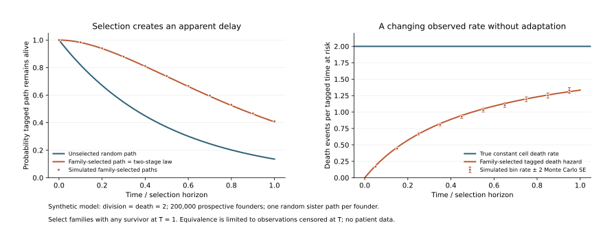

# Family selection can imitate two-stage cell killing

November 10, 2026. **We derived and independently checked an exact finite-horizon sampling identity:** a homogeneous cell population with one-step, constant-rate death can produce an apparent two-stage death-time distribution when founders are selected for having a surviving descendant and a random sister path is then observed. Related limiting results follow from established spine constructions in branching-process theory. This is a useful model-identifiability benchmark, not a claimed new theorem, cancer treatment or biological mechanism. Priority of the exact finite-horizon formulation remains unresolved.

The strongest implication is practical: under this observation model, the same selected death curve can accompany either a shrinking or a growing cell population. A verified founder-selection denominator or division histories can provide information the death curve lacks.

## What was tested

Each synthetic cell independently divides into two at rate lambda and dies at rate mu. At every tagged division, one daughter is chosen randomly without knowledge of future fate. At horizon T, retain founders whose families have any living descendant. The retained tagged path can have died while a sibling branch survived. This differs from selecting a path that itself reaches an endpoint survivor.

For positive rates and observations through T, the family-selected tagged lifetime has the same right-censored distribution as the sum of independent exponential waiting times with rates lambda and mu. At equal positive rates k, survival is `exp(-kt)(1+kt)` and the observed death hazard is `k^2 t/(1+kt)`, despite an unchanged true death rate k. Zero-rate cases are degenerate limits, not proper exponential distributions with rate zero. The equality is limited to observations censored at T. [Proof, competing sampling rules and corollaries](theory.md).



The figure illustrates the fixed grid case lambda=mu=2, T=1. Curves are exact model predictions. Points show simulated survival or event/person-time ratios; rate error bars are two pointwise Monte Carlo standard errors, not biological confidence intervals. No empirical cell data were used to choose or fit these rates.

## Verification

The [plan](sampling-simulation-plan.json) was [locally frozen](plan-freeze.json) before numerical simulation. Analytic derivations and source metadata were already known, so this is not blinded discovery or external preregistration.

| Check | Scope | Result |
|---|---|---|
| Tagged-path plus independent sister-subtree simulation | 200,000 prospective founders in each of 12 fixed cases: **2.4 million paths** | All cases retained; maximum survival-curve discrepancy 2.774 Monte Carlo SE; maximum event-bin rate discrepancy 2.852 SE. |
| Separate explicit branching-tree simulation | **120,000 full trees**, six fixed cases, independent seed and implementation | All 54 inclusion/survival checks within 1.906 Monte Carlo SE; population-balance and zero-rate fixtures pass. |
| Independent mathematical/numerical checks | 500 deterministic parameter/time combinations; Poisson-functional quadrature and sequential-state matrix exponential | Largest discrepancies approximately 1.01×10⁻¹⁰ and 9.36×10⁻¹⁵ respectively. |
| Rate exchange | Swapping lambda and mu in every fixed case | Selected death-law difference exactly zero in the checked arithmetic. |

Monte Carlo checks assess computation under the specified model. Their pointwise bounds are not simultaneous uncertainty bands, biological evidence or external peer review. The independent full-tree simulation checks survival/inclusion probabilities; it does not independently verify every event-bin integral. [All shortcut results](sampling-simulation/results.json), [full-tree review](full-tree-review.md), [estimand review](hazard-estimand-review.md), [identity checks](identity-check-results.json).

For the rate pair 0.5/2 and its reversal 2/0.5, selected tag survival at T=1 is **0.763596** in both cases. Yet unconditional mean population size per initial founder is **0.223130** versus **4.481689**, counting extinct families as zero. These are hypothetical whole-cohort expectations, not means restricted to retained families, patient survival or treatment effects. The [theory note](theory.md) explains how a known prospective family-survival fraction can resolve the death-rate label.

## A broader falsification rule, with important blind spots

The selected tag's death curve on a common early interval does not depend on which later survival-selection horizon is used. A [finite-horizon derivation](horizon-invariance/proof.md) shows that this invariance survives arbitrary shared deterministic **calendar-time** division and death schedules. It is not a test for constant rates. Nine frozen schedules, 270 case/horizon/time points and 54 cross-horizon comparisons passed three numerical formulations; the largest cross-horizon discrepancy was about `3e-14`. An [independent mathematical review](calendar-rate-independent-review.md) confirms the conditions and boundaries.

This suggests comparing the same early tagged-path observations under several later family-survival selections. A discrepancy could challenge the shared branching or observation model, but cannot uniquely identify inherited resistance. Agreement also cannot exclude all heterogeneity: a mixture of two constant-rate types with exchanged division/death rates passes exactly despite opposite population-growth signs. The [focused prior-art audit and design](horizon-invariance-prior-art.md) did not locate this exact empirical application in its bounded search; priority remains unestablished. Complete descendant ascertainment and an unchanged founder cohort are essential.

## What the real source data do and do not establish

The next empirical candidate was the published [Oren PC9 lineage study](https://www.nature.com/articles/s41586-021-03796-6). Its Figure 1 workbook is now pinned, read without modification and retained locally. The [source dictionary](source-dictionary.md), [structure audit](workbook-structure.json) and [encoding checks](encoding-checks.json) preserve the findings:

- Both lineage matrices contain 1,135 rows and 2,025 columns. Their numeric codes are monotone and compatible with cumulative encodings, but study-specific export semantics and observation masks remain unverified.
- The published imaging schedule changes from 10 to 20 to 60 minutes. It does not by itself identify the workbook's column-to-time map.
- The death matrix ends with 80 zeros, and the separate viability table has 80 explicit zero labels. The figure reports 77 persister lineages. This is an unresolved source reconciliation, not proof of a biological or labeling error.
- A positional comparison of the viability table and terminal death codes disagrees for 146 rows. Equal row counts do not authorize joining them by row number.
- Nonpersister random-sister tracking is documented. The exact chosen-path and inclusion rule for retrospectively ascertained persister founders is not certified by the inspected materials.

Consequently, **no empirical division, death or state-exit rate has been estimated**, and the synthetic identity is not attributed to this dataset. The original study's biological conclusions have not been disproved. Its different source tables, selected populations and observation rules must first be reconciled.

## Novelty and next research use

General lineage-selection bias, competing division/death risks and retrospective sampling already have substantial prior art. The [audit](novelty-and-identifiability.md) documents the primary literature and exact searches. A targeted extension found that related limiting two-exponential laws follow from known spine/backbone constructions; those limiting arguments are distinct from the finite-T proof here. The exact finite-horizon formulation/application was not located in the bounded search. Neither that search result nor independent derivation establishes first-ever discovery.

The current contribution is a precise, reproducible counterexample and a concrete data requirement: distinguish family ascertainment from path ascertainment, retain the prospective founder denominator, and measure division as well as death. The [denominator review](sampling-information-review.md) gives the conditions under which ascertainment information restores rate identity. The [current destination assessment](research-destination.md) identifies the HCT116 source researchers at NCBS as the closest scientific-validation route, this public repository as a reconstruction benchmark, and a completed methods/reanalysis study as a conditional journal route. The earlier [Iowa/MSK assessment](../discovery-2026-11-10/research-destinations.md) concerns the separate lung-expression track. No investigators have been contacted and no manuscript has been submitted.

A [second resource audit](next-empirical-resource.md) acquired the original Chakrabarti HCT116 colorectal-cancer event workbook and its codebook. The [completed structural audit](hct116-structure/README.md) reconstructed candidate cell episodes and identified 328 divisions with both daughters, 73 with one observed daughter and one with none. Its 394 rows are repeated lineage histories, not 394 independent founders. Later baseline cells often have apparently complete subtrees, but selecting them by future completeness can distort the test. Missing branches, treatment timing, identifier namespaces and absent replicate labels remain explicit. No empirical rate model or population null test has been fitted.

The [fixed-roster bounds analysis](missing-branch-bounds/README.md) now retains incomplete families and quantifies unknown daughters and uncertain family inclusion. A joint refinement narrowed every nonzero-time contrast range by a median 51.6%; all 240 still include zero, with another 60 time-zero controls. These are finite-record outer ranges, not confidence intervals or proof that a zero-valued biological completion exists. The result establishes neither a directional departure nor agreement with the population model. The [updated destination packet](missing-branch-bounds/research-destination.md) specifies source questions for scientific validation. The HCT116 and PC9 sources remain separate biological and sampling contexts.

Next work should test robustness to non-exponential cell cycles, inherited heterogeneity and imperfect tracking, then seek permitted data with the necessary timestamps, masks, lineage identities, sampling rules and independent replicates. Exact equivalence in an idealized model is insufficient to claim that selection explains a real persister phenotype.

## Reproduction and provenance

Use Python 3.12 with [requirements-treatment.txt](../../../requirements-treatment.txt) for the numerical simulations. The workbook extraction uses bundled Python/NumPy and standard-library ZIP/XML parsing; its exact environment is recorded. Raw source workbook and extracted arrays are excluded from publication. Reproduction can acquire the pinned public source with hash verification, subject to its source terms.

```sh
python scripts/audit_oren_lineage_workbook.py --download
python scripts/check_oren_lineage_encoding.py
python scripts/simulate_lineage_family_sampling.py --out tmp/lineage-reproduction
python scripts/check_lineage_family_sampling.py
python scripts/check_lineage_sampling_identity.py
python scripts/check_lineage_horizon_invariance.py --out tmp/horizon-invariance-reproduction.json
python scripts/plot_lineage_family_sampling.py
```

Run in a disposable checkout to preserve published timestamps. Simulations and independent identity checks require no workbook or other empirical data. The result files retain code/protocol hashes, environments, all fixed cases, exact controls and limits. The broader discovery goal remains active: a new cancer mechanism or therapeutic target has not been established.
