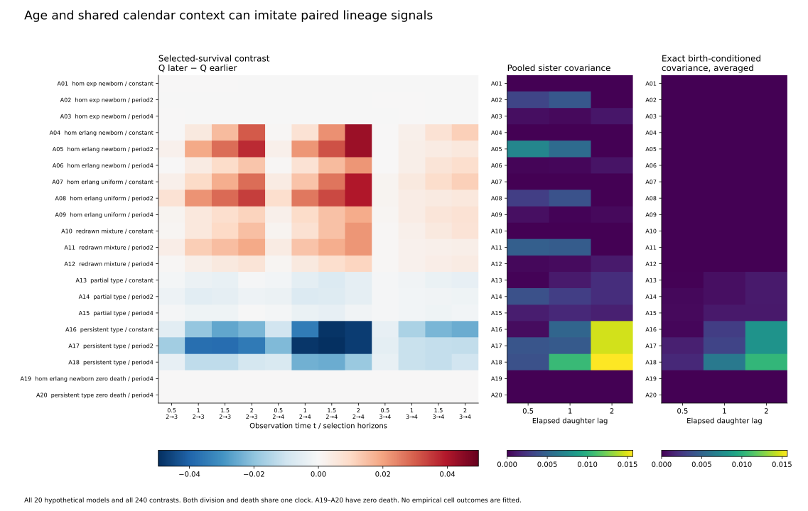
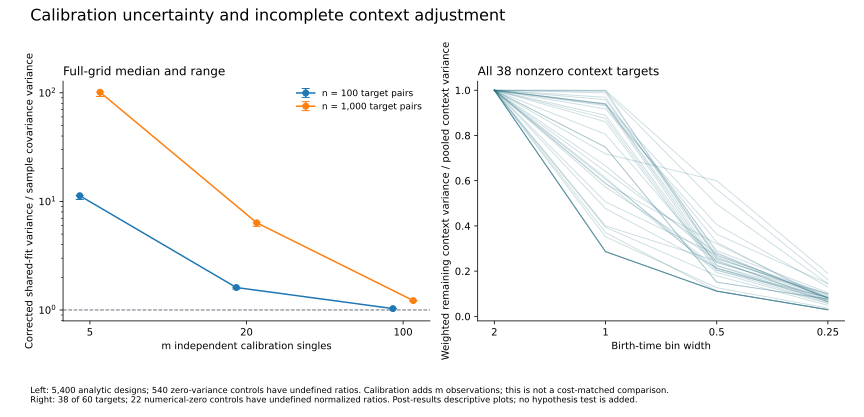

# Age, shared conditions and calibration in cancer lineage measurements

November 10, 2026. **Independent cell-cycle timing plus shared calendar conditions can create both a family-selection contrast and pooled sister-subtree covariance without transmitted cell type.** Knowing the exact birth context removes the specified context contribution; grouping births into bins does not remove it completely. Estimating one shared baseline adds another source of apparent dependence and uncertainty.

This is a reproducible measurement-control study, not a new cancer mechanism or treatment result. The time change, covariance decomposition, calibration-error effect and correction have substantial related prior art. The bounded [literature audit](prior-art.md) does not establish first-ever novelty. The useful output is a set of explicit counterexamples, finite-sample checks and requirements for testing real lineage records.

## Main findings across the entire fixed grid

The [protocol](protocol.json) fixes 20 hypothetical models, 240 horizon contrasts, 900 birth-bin/lag pair targets and 5,400 calibration settings. The [freeze](plan-freeze.json) preceded these numerical outcomes, after symbolic calculations, previous studies and source-schema inspection. It is a local design freeze, not external registration. Numerical sign summaries below use the declared 10⁻⁸ comparison scale; they are descriptive, not empirical significance tests.

| Question | Result | Meaning within this model |
| --- | --- | --- |
| Can age plus shared conditions imitate both signals without inheritance? | All six no-transmission, non-exponential, changing-clock cases have positive horizon contrasts at all 12 declared comparisons: 72/72. Pooled sister covariance is positive in 15/18 case-lag profiles. | Neither observing both signals nor their agreement identifies inheritance. The three zero pair profiles are the declared period-2/lag-2 aliases. |
| What happens with exact birth context? | Birth-conditioned sister covariance is zero in all no-transmission cases. | This removes the specified deterministic context term, assuming the context and its probabilities are known. Hidden shared environments remain an alternative. |
| Does finer binning solve the context problem? | Across 38 nonzero context profiles, refining width 2 to 0.25 reduces weighted remaining context variance by 80.97–97.08%, median 92.25%. | All retain a context contribution. The monotonic claim concerns the weighted partition average, not every individual bin. |
| What if all pairs reuse one estimated baseline? | The naive residual product has extra expectation `p(1−p)/m`. Correcting that expectation leaves a variance floor `2[p(1−p)]²/[m(m−1)]`. | Adding target pairs alone cannot eliminate error shared through the calibration fit. |
| Is that corrected estimator preferable to ordinary sample covariance? | Its variance is higher in all 4,860 positive-death settings at the same number of target pairs; ratios range 1.028–101.575. The other 540 settings have zero variance. | Ordinary unbiased sample covariance is the essential simpler benchmark. Calibration additionally uses m independent observations; this is not an equal-total-cost comparison. |

Across all 240 horizon contrasts there are 108 positive, 72 negative and 60 numerical-zero results. The latter include exponential and zero-death controls. All case-level results, including aliases and opposite signs, are retained in [results.json](results.json), with stricter numerical settings in [strict-results.json](strict-results.json). The [descriptive figure ledger](figure-provenance.json) records the entire plotted grid and its post-results choices.

The [full-grid interpretation](deterministic-interpretation.md) supplies strata, extrema, every calibration-size comparison and independently checked aggregation recipes.

The sign separation in this particular grid is not a universal inheritance test: the earlier study already found negative contrasts under independently redrawn exponential mixtures. In inherited-type models, the maternal-type composition can also vary with birth time even under a constant clock.



## What the models assume

Each cell has one or four sequential division stages, a common death rate, and either one division-speed type or two hypothetical types. Daughters begin at stage one. Two-type transmission ranges from independent redraws through partial to perfect persistence. Founder stages are newborn or uniformly distributed; uniform stages are not an equilibrium population-age distribution.

The shared calendar multiplier is constant or sinusoidal with amplitude 0.75 and period 2 or 4. **Both death and division-stage rates change proportionally.** This permits an exact operational-time transformation and does not cover arbitrary separate division/death responses. All units are dimensionless; there is no clinical dosing or fitted exposure schedule.

`Q_T(t)` is chronological random-daughter survival, conditional on the founder family having any descendant alive at T. A daughter path is chosen without knowing future fate. Sister pairs qualify at the founder's first division before its death and before calendar time 2; no later-survival or complete-tree filter determines eligibility. These are complete-observation synthetic experiments. The [theory](theory.md) is the preserved pre-freeze proposal; the final protocol governs the executed grid.

For birth time b and elapsed daughter lag s, the pooled covariance decomposes as

```text
pooled covariance = average birth-conditioned covariance
                  + variance of birth-specific survival probabilities.
```

Bins retain the second term within each bin. Even exact adjustment cannot universally distinguish inherited intracellular state from a persistent unobserved family environment. Zero covariance also does not establish biological independence outside the stipulated model.

## Calibration assumptions and the simpler benchmark

The calibration model uses m independent singles from separate families, drawn from the same context distribution as n independent target sister pairs. It reuses `q=X/m`, with `X~Binomial(m,p)`, across all pairs. Conditional on that fitted q, the residual-product expectation is `c+(p−q)²`, where c is the target pair covariance. Independent training does not make this squared prediction error disappear.

Subtracting `q(1−q)/(m−1)` removes the extra expectation **averaged over both calibration and target sampling**. It is not unbiased conditional on one realized training sample. A training/test probability mismatch leaves the squared difference of their means. General regression estimates do not obey this binomial correction automatically; cross-fitting alone does not guarantee zero finite-sample product bias. [Derivations and prior art](prior-art.md).

The ordinary unbiased target sample covariance uses no calibration set and targets the same within-bin covariance. The corrected shared-fit estimator's larger variance is an unfavorable result retained in full. Neither estimator removes the within-bin context contribution or identifies its cause.



## Numerical verification and retained failure

Two independently implemented deterministic formulations agree across **192,290 numerical comparisons**, covering 96,145 fields for both primary and strict results. Maximum primary/reference differences are below 5.47×10⁻¹⁰ overall and 1.56×10⁻¹¹ for calibration moments, within the frozen limits. Exact rational enumeration checks small-sample estimator identities, and separate physical-time equations check the operational-time mapping. [Full coverage and exclusions](independent-comparison.md).

A [fresh-checkout reproduction](deterministic-reproduction.md) exactly matches 349,971 numeric values across the deterministic results and fixtures, excluding timestamps and runtimes. This checks computational reproducibility, not empirical validity.

The full-tree simulator completed **200,000 prospective founder families**, generating 5,163,538 cells in 800 saved batches. It uses explicit trees, independent random streams and no primary ODE imports. It derives its tree/checkpoint architecture from the previous study, so it is not wholly independent of that earlier simulator. All 20 cases completed without truncation. [First tree results](tree-monte-carlo/results.json).

Its [frozen comparison](tree-monte-carlo/comparison.md) retains all 3,070 exact-binomial diagnostics and 720 bounded-mean diagnostics: 3,646 not flagged and 144 structural agreements, with no undefined denominators. Each of the two diagnostic families has error budget 0.001; their combined union-bound budget is 0.002, subject to the stated numerical-reference caveat. Sister covariance and horizon contrasts are descriptive alongside these component checks; no new Gaussian standard-error test was applied.

The calibration simulator generated **36 million whole experiments** in 720 settings and 7,200 immutable batches. Its first process then failed while packaging the final report: run metadata replaced each setting's estimator dictionary with a method-name list. The first code, failure and saved batch moments are retained. Reconstruction uses those same moments without new random draws or altered thresholds. See the [implementation notes](monte-carlo-implementation.md) and the recovery evidence alongside the final result. The initial static review missed this packaging defect; it is not presented as having caught it.

The [reconstructed first results](calibration-monte-carlo/results.json) contain all 5,760 frozen whole-experiment mean and squared-deviation checks: 5,184 not flagged and 576 structural agreements, with no incomplete settings. The [recovery ledger](calibration-monte-carlo/recovery-ledger.json) verifies every saved batch hash, experiment count, seed/design record and RNG-state chain. No draws were replaced. Each check family uses its declared multiplicity adjustment; these are implementation diagnostics, not tests of cancer-cell biology.

Both simulations also passed [same-seed reproduction](monte-carlo-reproduction.md), comparing all 10,400 tree arrays, 7,200 calibration batches, 2,880 estimator records and diagnostic outcomes exactly. A [separate supplementary check](monte-carlo-reproduction-supplement.json) verifies array types/shapes and additional provenance. The corrected calibration runner changes only the conflicting metadata key. First results, original code, failure and recovery remain preserved; repeated seeds do not constitute independent statistical replication.

The statistical checks assess numerical implementation under synthetic assumptions, not biological uncertainty or clinical validity. Exact binomial and bounded-mean gates were specified in advance; their numerical-reference slack is not certified interval arithmetic. This study does not clear or reinterpret the previous [72-model study's two approximate Monte Carlo flags and 168 low-count unresolved checks](../cell-cycle-specificity/README.md).

## Where the research can go

The [new Kuchen source audit](../kuchen-source-audit/README.md) acquired neuroblastoma workbooks with 4,678 sister-pair rows and explicit birth/division/death/loss fields. That creates a concrete possible application: test whether an age/context model predicts held-out recorded-at-birth sister-subtree outcomes, with explicit observation rules and family clustering.

That empirical test has not been run. Four negative loss durations, one absent descendant pair, uncertain source selection/censoring, unresolved biological-versus-technical replication and inconsistent rapamycin metadata remain. The source authors already analyzed cycle correlations and several temporal/spatial confounds. Resolving those questions comes before a new prospective model test; retained-record compatibility bounds remain possible if full eligibility cannot be certified.

The [destination brief](research-destination.md) identifies source-owner validation and relevant lineage-methods researchers as the scientific review route, with a conditional methods/reanalysis submission route after an original, justified contribution is demonstrated. No investigators have been contacted, and no manuscript or preprint has been submitted. The broader discovery goal remains active.

## Reproduction

Use Python 3.12 and the root [requirements-treatment.txt](../../../../requirements-treatment.txt). Run in a fresh checkout or use unused output names: scripts preserve first outputs rather than overwrite them. No source workbook is needed for the synthetic study.

```sh
python scripts/age_calendar_calibration.py --run --out tmp/age-calendar-primary.json --strict-out tmp/age-calendar-strict.json
python scripts/verify_age_calendar_calibration.py --run --out tmp/age-calendar-reference.json
python scripts/compare_age_calendar_references.py --run --out tmp/age-calendar-reference-check.json
python scripts/simulate_age_calendar_trees.py --run --local tmp/age-calendar-trees --output tmp/age-calendar-trees.json
python scripts/plot_age_calendar_calibration.py --out tmp/age-calendar-figures
```

The reference comparator above checks the pinned published deterministic inputs; a fresh-run comparison must separately match the newly generated scientific records. Timestamps and runtimes can differ. Code pins, environments, fixture reports, first outcomes and comparisons are retained in this directory. The [calibration recovery and clean-run instructions](monte-carlo-reproduction.md) document the preserved first-run defect rather than silently rewriting its provenance.
