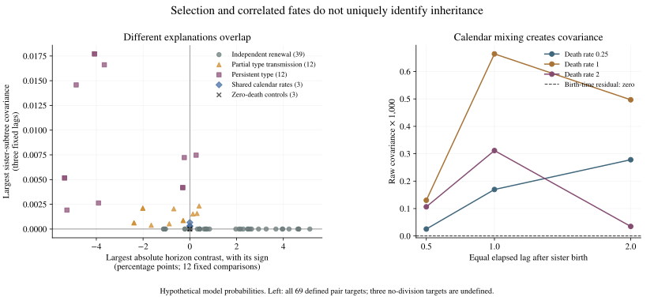
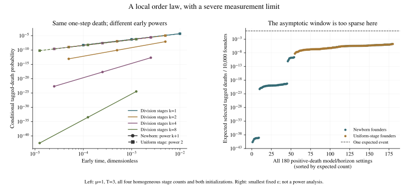

# Cell-cycle timing can imitate lineage-selection signals

November 10, 2026. **Useful model result: a change in a family-selected survival curve does not, by itself, identify inherited resistance.** Independent cell-cycle timers produce changes in either direction in this study. Prospective sister-subtree measurements add information under specified assumptions, but shared conditions and founder age limit that interpretation. These are synthetic observation-model findings, not a discovered cancer mechanism or treatment.

The fixed study contains **72 model records, 720,000 simulated founder families and 48,568,750 generated cells**. Every case completed; none was omitted or stopped by a resource guard. Independent deterministic formulations agree throughout the grid. The separate simulation comparison retains **two failed approximate-error checks and 168 low-precision unresolved checks**. The findings and failures are both part of this release.

## Question and observations

Each prospective founder starts a branching family. Cells divide after a potential cell-cycle timer or die first at an independent constant rate. A tag follows one daughter fairly at every division, without knowing future outcomes. Define `Q_T(t)` as the probability that this tag remains alive at time `t`, conditional on **any** member of its founder family remaining alive at a later selection time `T`. We compare `Q_T2(t) − Q_T1(t)` at the same `t`. This is different from tracing the ancestry of an endpoint survivor.

A separate prospective cohort takes the first division of each founder before a fixed cutoff. Both newborn daughters are followed for equal elapsed lags, retaining extinct subtrees. The second measurement is covariance of the two binary indicators that a daughter has any living descendant at that lag. It is not covariance of accumulated births or a statistic restricted to successful families.

The [protocol](protocol.json) fixes the 72 cases, clocks, founder initialization, type transmission, observation rules, horizons, controls, seed, sample counts and checks. The [local plan freeze](plan-freeze.json) preceded these numerical outcomes; symbolic derivations, source findings and analytic resource estimates were already known. It was not externally preregistered. Time and rates are dimensionless and uncalibrated to a cell line or treatment.

## What the full grid shows

| Construction | Main result |
|---|---|
| Homogeneous exponential division, positive death | Horizon contrasts are zero by the earlier identity; numerical controls agree. |
| Independent non-exponential renewal timers, positive death | All 30 records have nonzero contrasts at every declared comparison. Independently redrawn exponential-rate mixtures give negative contrasts; homogeneous Erlang timers and the declared Erlang mixtures give positive contrasts. Sister-subtree covariance remains zero. |
| Deterministic newborn division age | Contrasts remain zero through the first division time, then can change without inheritance. |
| Partially or perfectly transmitted timer types, positive death | All 24 records have nonzero contrasts and positive sister covariance, but contrast sign varies. |
| Shared changing calendar division rate | Horizon contrasts remain zero, yet pooled sister covariance is positive because both daughters share their birth time. The residual using the known birth-specific survival probability has expectation zero. |
| No division / zero death | No-division sister covariance is undefined. Zero-death controls give no survival contrast or covariance even when type is inherited. |

Within the primary grid, contrasts without transmitted type range from approximately **−1.12 to +5.13 percentage points**. These are extrema over hypothetical parameters, not estimated cancer effects. The [complete interpretation review](interpretation-review.md) retains every model stratum and explains blind spots, eligible-mother weighting and the limited matching between alternatives.



*Left: all 69 cases with defined sister measurements, including controls. Each point uses its signed largest absolute contrast among 12 planned comparisons and its largest covariance over three planned lags; those extrema need not occur at matching times. Three no-division cases remain in the results with undefined pair measurements. Right: all nine shared-calendar pair targets and their known-context residual expectation. These are descriptive exact-model summaries, not estimates with simulation error bars or a trained classifier.*

The grid tests age dependence and shared changing calendar context separately. It does not yet test their combined no-transmission model. More fundamentally, an unobserved permanent family environment with the same conditional tree laws is exactly observationally equivalent to a perfectly inherited type. Tree statistics alone cannot universally distinguish those labels. Additional restrictions, measured context or an intervention would be needed.

## An early-time prediction, with a practical limit

For an independent newborn Erlang division timer with shape `k` and stage rate `α`, and constant death rate `μ`, the [derivation](theory.md) gives, at any fixed positive selection horizon,

`1 − Q_T(t) = μ α^k t^(k+1)/(k+1)! + O(t^(k+2))`.

The leading coefficient does not depend on the selection horizon in this newborn independent-renewal construction, even though the full finite-time curve usually does. An early dead tag can be in a surviving family only after an earlier division leaves a sister branch. The power therefore need not count biological killing stages. Uniformly mixing initial cell-cycle stages changes the leading order to two and can make its coefficient depend on the horizon without inheritance. That initialization is not asserted to be a stable population age distribution.



*Left: a stated visual slice, homogeneous models with death rate 1 and selection horizon 3, all four Erlang shapes and both initializations. Right: all 180 positive-death Erlang case/horizon combinations at the smallest frozen epsilon. For one fair random tag per founder, expected selected tagged deaths per 10,000 founders range from `2.20e−41` to `1.67e−5`. This post-results resolution check is not a power analysis or a physical-time prediction. The deterministic branching equations evaluate these tiny probabilities numerically; the finite Monte Carlo cohort does not verify their sampling resolution.*

All 567 early-time records are retained. The 540 positive-loss ratios satisfy the declared analytic envelope; at the smallest epsilon the maximum departure from the leading term is about `1.00e−4`. The 27 zero-death ratios remain undefined with zero loss. No Monte Carlo resolution of these tiny early-time events is claimed.

## Validation, including failures

The [independent deterministic comparison](independent-comparison.md) checks **13,478 scalar quantities against both the primary and tighter-tolerance calculations**. All meet the frozen gates. The independent implementation uses extinction/forward-spine and Volterra equations rather than importing the production implementation. Maximum primary/reference differences are `1.23e−9` for selected survival, `1.68e−9` for horizon contrasts and `1.81e−11` for sister covariance. Agreement is numerical, not a formal interval-arithmetic certificate or external peer review.

The independent event-level simulator builds complete trees for 10,000 founders per case. Its [first comparison](monte-carlo/comparison.md) retains all **331 exact-binomial probability diagnostics, 2,829 quantity diagnostics and 144 accounting checks**. None of the probability or accounting checks is flagged. Quantity results are:

| Frozen classification | Count |
|---|---:|
| Structural agreement | 507 |
| No six-standard-error flag | 2,143 |
| Unresolved because of low counts | 168 |
| Failed six-standard-error check | 2 |
| Expected undefined no-division pair target | 9 |

The two flags are contrasts at `t=0.5`, selecting at 3 versus 4, in cases C07 and C13. The simulated contrasts are negative while the exact values are small positive numbers. Recalculation from saved founder records reproduces both estimates and their reported standard errors. The normal-error diagnostic is approximate, and a large selected denominator alone does not guarantee enough contributing rare events. The [post-results diagnostic](monte-carlo/sparse-contribution-diagnostic.md) examines that issue across all contrasts; it does not remove the flags, replace the frozen test or prove that sampling is the only possible explanation.

The [deterministic reproduction](deterministic-reproduction.md) and [complete-tree reproduction](monte-carlo-reproduction.md) document fresh runs. Reproducibility and independent numerical agreement are separate checks; repeating a seeded calculation does not resolve the two statistical flags. Original outcomes, seeds and thresholds are preserved.

## Prior art and research destination

Age-structured branching, Erlang cell cycles, competing exponential death, sister-subtree statistics and shared-context confounding already have close prior art. The Erlang-plus-exponential convolution already has the familiar early power and coefficient. The [bounded literature audit](prior-art.md) did not locate this exact combined specificity exercise or the exact finite-horizon selection cancellation in its inspected sources; that is **not evidence of first-ever novelty**.

In particular, [Iyer et al.](https://journals.plos.org/ploscompbiol/article?id=10.1371/journal.pcbi.1013446) already include age-dependent hazards and inheritance alternatives. Our age-only counterexamples do not show that their analysis omitted age dependence or refute their inference. [Korsnes & Korsnes](https://pmc.ncbi.nlm.nih.gov/articles/PMC10686135/) already discuss covariance of sister-subtree summaries. [Yates et al.](https://arxiv.org/html/1705.09718v2) supply closely related multistage/convolution mathematics.

The immediate application is a reusable observation-model stress test before interpreting recorded cancer-cell trees. The [research-use and destination note](research-use.md) identifies the next experiment-design requirements and links the source-validation packet for Shaon Chakrabarti's NCBS group. A technically justified methods/reanalysis manuscript could eventually be considered for PLOS ONE after source clarification and human scientific review. No researcher has been contacted, collaboration arranged or manuscript submitted.

## Reproduce and inspect

Use Python 3.12 and the repository's [treatment requirements](../../../../requirements-treatment.txt). No empirical source workbook, participant data or external download is needed for these hypothetical models. From the repository root, choose new output paths; the scripts refuse to overwrite first results:

```sh
python scripts/run_age_lineage_models.py --out tmp/age-reproduction/results.json --strict-out tmp/age-reproduction/strict-results.json
python scripts/verify_age_lineage_models.py --fixtures --out tmp/age-reproduction/reference-fixtures.json
python scripts/verify_age_lineage_models.py --run --out tmp/age-reproduction/independent-reference.json
python scripts/simulate_age_lineage_trees.py --run --local tmp/age-reproduction/trees --output tmp/age-reproduction/monte-carlo.json --fixture-report tmp/age-reproduction/tree-fixtures.json
```

The exact saved environment is Python 3.12.14, NumPy 2.3.5 and SciPy 1.16.3. All full-tree checkpoints are locally generated synthetic files; their large per-founder arrays are not mirrored. The public aggregate, seed, generator, batch order and frozen protocol reproduce them. Cross-version or different-batch numerical/RNG invariance is not promised. See the reproduction reports for full comparisons and commands. The comparison scripts intentionally bind the original outputs and pins; use a disposable copy for re-evaluation, preserving the published evidence.

Files of record: [primary results](results.json), [strict results](strict-results.json), [independent reference](independent-reference.json), [full-tree aggregates](monte-carlo/results.json), [all comparison records](monte-carlo/comparison.json), [implementation review](implementation-review.md), [theory](theory.md), [display provenance](display-summary.json), and [interpretation audit](interpretation-review.json).
