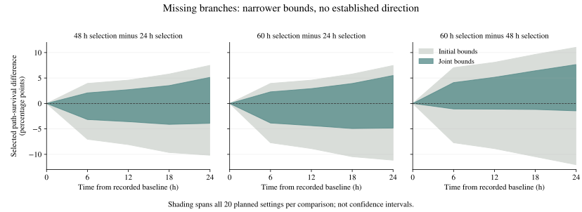

# Missing branches: what the recorded cell families can establish

November 10, 2026. **Accounting jointly for the same cell family in two survival-selected averages narrowed every nonzero-time uncertainty range, by a median of 51.6%. All 240 nonzero-time ranges still include zero.** The other 60 comparisons are time-zero controls and equal zero by construction. This is a reproducible measurement result from a published HCT116 colorectal-cancer cell-line workbook; it does not establish a biological resistance mechanism, treatment effect or cancer cure.

The useful output is a way to retain incomplete cell families without silently calling missing daughters dead or selecting only families with complete future records. The calculation also identifies the source information that needs validation before a population-level test. Its statistical ingredients have substantial prior art; first-ever novelty has not been established.



Shading spans all 20 planned baseline/annotation settings at each comparison and evaluation time. These settings include different recorded rosters: the displayed hull is **not one identified set or a confidence interval**. Straight connections between the five evaluated times are visual guides. The [complete results](joint-results.json) retain every individual interval; the [display summary](display-summary.json) records the plotted endpoints and width calculation.

## The question and recorded cohort

An earlier [branching-model result](../README.md) predicts that, under its assumptions, selecting families at different later survival horizons leaves the same early chronological-path survival curve. Real recordings have missing branches and ambiguous annotations. Before comparing such curves, we asked how much these gaps could change the finite recorded-cohort averages.

We used the original [Chakrabarti et al. HCT116 lineage workbook](https://www.nature.com/articles/s41467-018-07788-5), pinned by SHA-256 and checked against its codebook. This is a separate experimental system from the project's lung-cancer expression work. The [structural audit](../hct116-structure/README.md) identified candidate cell episodes, incomplete daughter observations and unresolved source identifiers. The current [readiness check](structure-readiness.md) additionally verified one same-frame division/apoptosis coannotation in the original workbook. It is treated as unknown, not assigned whichever fate favors a result.

| Fixed design choice | Values |
|---|---|
| Candidate baseline frames | 97, 98, 99, 100, 101; all retained because treatment-time convention is unresolved |
| Recorded baseline cells | 277, 280, 284, 289, 291 respectively; no post-baseline completeness filter |
| Event-time sensitivity | Apoptosis becomes death at its annotated frame or the following frame |
| Ambiguity sensitivity | Unknown from the first issue, or a coarser whole-episode cutoff that preserves known baseline survival |
| Family-survival selection horizons | 24, 48, 60 nominal hours after each baseline |
| Common evaluation times | 0, 6, 12, 18, 24 hours |
| Comparisons | Later minus earlier: 48−24, 60−24, 60−48 hours; 300 total contrasts |

Frames represent nominal half-hour imaging coordinates, not certified continuous event times. Observed baseline cells are retained irrespective of later completeness. The five overlapping rosters and repeated sensitivities are **not independent experiments**. Original eligibility, field/replicate mapping and the relationship between source identifiers remain unresolved.

## How the bounds work

For baseline family `i`, let `u_i(t)` be the probability that a randomly chosen forward daughter path remains alive at time `t`. At each documented binary division, each biological daughter gets half the parent's path weight. Unobserved daughters keep their weight as unknown; the observed daughter never receives a replacement weight of one. Known earlier death is absorbing. Ambiguous identities and simultaneous contradictory annotations are quarantined under the fixed rules.

Let `f_i(T)` indicate that any descendant is alive at selection time `T`. The finite-roster summary is `Q_T(t) = sum(f_i(T) * u_i(t)) / sum(f_i(T))`, when its denominator is positive. Known live descendants force inclusion; complete known extinction forces exclusion; otherwise inclusion is uncertain.

The [initial calculation](results.json) separately bounds each selected mean and applies a safe nesting restriction. The [joint refinement](math-implementation.md) uses the **same `u_i(t)` in both averages** and requires that a family surviving to the later time also survived to the earlier time. Dynamic programming optimizes over feasible early/later inclusion counts and the allowed interval endpoints. It narrows the relaxation without deleting families or changing the planned times.

These are outer ranges for possible finite-record values under the stated observation assumptions. The joint solver finds the extrema of a closed rectangular/nested relaxation. It does not enforce every constraint of a realizable biological tree. Zero inside a range therefore does not prove that a biological completion with exactly zero contrast exists. The ranges also omit sampling uncertainty and are not tests of the population branching law.

## Results and verification

All 240 nonzero-time joint intervals are strictly narrower than their initial counterparts. Median width reduction is **51.565%**, with reductions from **43.710% to 65.507%**. Every joint interval contains zero even without applying the numerical comparison tolerance. Thus this analysis establishes no directional departure; it also does not confirm the model, rule out inherited heterogeneity, or prove that the dataset is fundamentally uninformative.

At the last evaluated time, 24 hours, the ranges across all planned configurations are:

| Selection comparison | Joint range across configurations, percentage points |
|---|---:|
| 48 hours minus 24 hours | −3.90 to +5.13 |
| 60 hours minus 24 hours | −4.83 to +5.50 |
| 60 hours minus 48 hours | −1.45 to +7.65 |

These are descriptive hulls across different settings, not pooled effect estimates or confidence intervals. The direction is a difference in selected path-survival probabilities, not a difference in patient survival or drug efficacy.

| Independent check | Scope and outcome |
|---|---|
| Source/path reconstruction | [Primary empirical review](empirical-review.md): 39,788 distinct cell/time mass vectors and all 300 mean/300 contrast envelopes reproduced with a separate exact-rational path calculation |
| Initial-bound arithmetic | [Production check](production-check.md): 810 ratio comparisons and 8,200 nested-selection assignments passed |
| Deliberately missing branches | [Full-forest check](forest-verification.md): 900 unique synthetic founders, four recording policies, both timing offsets and ambiguity policies; 201,600 path-mass, 720 mean and 720 contrast containment checks passed |
| Joint-bound arithmetic | [Joint verification](joint-verification.md): 4,495 exact-rational cases and 8,961 solver calls passed |
| Joint bounds on incomplete forests | The fixed first 12 founders in each of the three forest cases: **36 unique founders**; all 560 defined contrasts contained, 160 undefined true contrasts retained explicitly |
| Joint empirical calculation | [Independent review](joint-empirical-review.md): full fixed grid, shared path values, nested selection, containment and width summaries checked separately |

Synthetic containment is a computational test conditional on each generated tree, not empirical confidence coverage. Floating-point comparisons use `1e-12`; this is a numerical tolerance, not a significance threshold or a formal outward-rounding certificate. The full input, source, code and protocol hashes are in the linked records.

## What was known before each analysis

The [initial plan](protocol.json) was [locally frozen](plan-freeze.json) before these empirical bounds and the synthetic forest outcomes were examined. The previous model derivation, source structural counts and published study aggregates were already known. This was not external preregistration or blinded discovery.

After the initial calculation showed zero in every contrast range, the [joint refinement plan](joint-refinement-plan.json) was [frozen separately](joint-refinement-freeze.json) before the joint empirical results. It preserves the entire original grid. The independent exact and synthetic checks preceded the empirical joint run. The [implementation notes](implementation-notes.md) preserve a pre-outcome timing-API clarification; first results were retained without replacement.

## Prior art and where this research goes

The [focused literature audit](prior-art.md) found direct prior art for bounds on conditional means when outcomes and the conditioning event are both incompletely observed. Chronological lineage weights and incomplete-tree inference also have established antecedents. An independent derivation and failure to locate an exact application in a bounded search do not establish priority.

The next scientific step is source validation, with the HCT116 source researchers at NCBS the closest route identified. The [research-destination packet](research-destination.md) specifies the unresolved encoding, timing and eligibility questions and the evidence needed for a review. A complete methods/reanalysis study remains a conditional publication route. **No researcher has been contacted and no manuscript has been submitted.**

Further useful work could quantify which missing observations would narrow these ranges, enforce additional justified tree constraints, or test a verified prospective dataset with independent experimental units. Any such expansion needs its own fixed question and validation. This result alone does not authorize an empirical null rejection or a therapeutic claim.

## Reproduce

Use Python 3.12 and [requirements-treatment.txt](../../../../requirements-treatment.txt), from the repository root. Run in a disposable checkout because two independent checkers write their output beside their input protocol. No workbook is needed for these numerical checks:

```sh
python research/treatment-discovery/lineage-audit-2026-11-10/missing-branch-bounds/verify_bounds.py
python research/treatment-discovery/lineage-audit-2026-11-10/missing-branch-bounds/check_production_bounds.py
python scripts/verify_lineage_missing_forest.py --out tmp/forest-check.json
python scripts/verify_lineage_joint_bounds.py --out tmp/joint-check.json
python scripts/plot_hct116_missing_bounds.py --out tmp/bounds-figure
```

Empirical reproduction additionally needs the pinned original source workbook and reconstructed private graph. Follow the [structural reproduction instructions](../hct116-structure/README.md), then run `scripts/bound_hct116_lineages.py`, `scripts/refine_hct116_lineage_bounds.py` and the independent empirical review scripts in that disposable checkout. The primary driver writes the per-cell file required by the joint driver. Source hashes are enforced; the public package includes aggregate results and authored code, not the source workbook, graph or per-cell extracts. These inputs are kept separate from public synthetic controls and must be acquired under their source terms.
