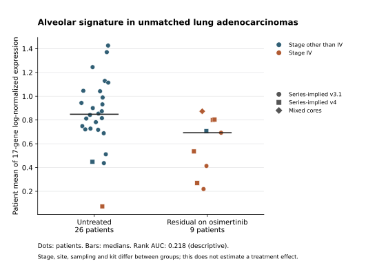

# Independent alveolar-signature comparison

Completed November 10, 2026. **This dataset does not give a clean confirmation of higher alveolar-signature expression in residual disease.** The pooled comparison points in the opposite direction, but the direction reverses in the small newer-kit subset. Major differences in stage, tissue sampling and sequencing remain unresolved. This is a descriptive expression analysis, not a causal resistance finding or a treatment result.

**Later November 10 context:** the [novelty audit](../../discovery-2026-11-10/novelty-audit.md) verified that the source study's 2025 preprint already reported declining alveolar signatures using different genes/processing. A lower pooled alveolar signal is therefore not a newly discovered biological observation. Subsequent [depth simulations](../../discovery-2026-11-10/depth-simulation/README.md) retain the opposite kit-stratum directions after equal-depth sampling. This contextual addition does not change the frozen plan, scores or intervals below.

## What was calculated

We verified the exact Maynard 17-gene alveolar signature against Table S2 and author code, then applied its mean log-normalized-expression formula to an independent public MSK cohort, [GSE292469](https://www.ncbi.nlm.nih.gov/geo/query/acc.cgi?acc=GSE292469), released November 1, 2026. The cohort comprises different patients in each treatment state; it is not an Iowa cohort. The [plan](../../updates/2026-11-10/analysis-plan.md) was fixed after metadata inspection and before expression scores, with its [timestamp and hash](../../updates/2026-11-10/analysis-plan-freeze.json). It was not externally preregistered.

All 457,724 nuclei matched uniquely between the raw UMI H5 and cell metadata. Matrix-derived library totals and detected-gene counts matched the deposited QC fields for every nucleus. All 17 genes had unique feature mappings; this H5 uses gene symbols for both its feature-ID and name fields, not Ensembl IDs. The matrix contains 33,514 features, 166,112 deposited tumor nuclei and 73 sample IDs. We accepted the source malignant/singlet annotations rather than inferring them from the signature.

For each nucleus, each gene contributes `ln(1 + 10000 × gene UMI / total gene UMI)`. The 17 values, including measured zeros, are averaged. Cell scores are averaged within each specimen, then each specimen has equal weight in state comparisons. MRD2's two cores remain one patient. Primary eligibility requires LUAD histology, TN or MRD state, and at least 20 malignant nuclei. Progression, transformed histology and insufficient tumor yield are explicit exclusions.

## Observed results

The primary comparison contains **26 untreated and 9 residual-disease patients**. Mean scores are **0.8534 untreated versus 0.5903 residual**, giving residual minus untreated **−0.2631**, conditional bootstrap 95% interval **−0.4528 to −0.0822**. Median scores are 0.8481 and 0.6926 respectively; median difference is −0.1555.

The rank AUC for residual scoring higher than untreated is **0.2179**, conditional interval **0.0769–0.3889**. Thus a randomly selected residual sample scores higher in about 22% of the observed between-group pairings. This is a descriptive ordering statistic; it is not clinical predictive accuracy or a probability of treatment benefit. Cliff's delta is −0.5641.

All prespecified sensitivities are reported:

| Analysis | Untreated / residual patients | Mean difference, residual minus untreated | Rank AUC, residual above untreated | Conditional AUC 95% interval |
|---|---:|---:|---:|---:|
| Primary | 26 / 9 | −0.2631 | 0.2179 | 0.0769–0.3889 |
| At least 100 malignant nuclei | 25 / 8 | −0.2402 | 0.2500 | 0.0950–0.4350 |
| Lung site | 25 / 7 | −0.2559 | 0.2171 | 0.0686–0.4057 |
| Exact E746_A750del or L858R token | 13 / 6 | −0.2136 | 0.2821 | 0.0641–0.5513 |
| Series-implied v3.1 kit | 24 / 3 | −0.4611 | 0.0417 | 0.0000–0.1667 |
| Series-implied v4 kit | 2 / 5 | **+0.3620** | **0.9000** | 0.6000–1.0000 |
| Equal weighting of MRD2 cores | 26 / 9 | −0.2564 | 0.2308 | 0.0769–0.4145 |

Intervals come from 10,000 state-stratified patient bootstrap resamples, NumPy 2.3.5, seed 20261110. They condition on the sampled patients, source annotations and assay; they do not cover confounding, batch effects, annotation error or source selection. In particular, resampling two untreated v4 patients cannot establish a stable population effect. The v4 reversal must not be selected as validation while discarding the pooled and legacy-kit findings.



## Why the biological interpretation remains unresolved

- **Stage and tissue differ sharply.** Only 1/26 untreated specimens is stage IV, versus 8/9 residual specimens. That untreated stage-IV specimen is lymph node; no matched stage-IV untreated lung comparison exists. Seven residual and 25 untreated specimens are from lung. These data cannot isolate an on-treatment change from differences between tumors selected for sampling.
- **Kit is entangled with state.** Eligible untreated samples are mostly legacy-kit libraries; residual samples are mostly newer or mixed libraries. The Series and individual GSM protocol descriptions conflict about kit versions. Stratum results are conditional on the Series-implied assignment, and the observed reversal makes a universal direction untenable.
- **Residual disease is heterogeneous.** The source defines MRD as on osimertinib after shrinkage and before progression, but treatment durations and co-mutations vary. The source's MRD specimen LX2019 is labeled SCLC and was excluded from this LUAD analysis.
- **Expression is assay-specific.** This calculation uses deposited raw nuclear UMI counts. The cohort authors' plotting pipeline uses a SoupX-corrected assay in other objects. Ambient RNA and single-nucleus versus single-cell measurement can affect an alveolar-marker signature. This is not an exact reproduction of their plots or proof that the measured signal reflects malignant-cell biology alone.
- **No causal intervention was tested.** Signature expression does not establish a vulnerability, combination benefit, normal-tissue safety, survival benefit or cure. The original source also has only one common-EGFR/osimertinib pair with at least 10 malignant cells in each state, so it cannot supply a strong paired validation by itself.

## Files and reproduction

[results.json](results.json) contains every estimate, interval, feature mapping, input hash, code hash and confounder cross-tab. [sample-scores.json](sample-scores.json) contains original derived specimen scores, nucleus counts, exclusions and minimal source labels; no raw cell matrix, names, birth dates or direct identifiers are redistributed. [Acquisition manifest](../../updates/2026-11-10/acquisition-manifest.json), [source review](../../updates/2026-11-10/independent-cohort-review.md), [signature verification](../../updates/2026-11-10/signature-verification.md), and [original-cohort audit](../../updates/2026-11-10/malignant-membership-review.md) preserve provenance and access limits.

Use Python 3.12 and `pip install -r requirements-treatment.txt`. Obtain the exact source files listed in the acquisition manifest, verify its hashes, and place them in its project-relative local paths. The raw count H5 is 12,553,420,880 bytes and is deliberately not committed to GitHub. The metadata builder produces the derived sample metadata from the three pinned GEO source files:

```sh
python scripts/build_gse292469_sample_metadata.py \
  --series research/treatment-discovery/sources/egfr-resistance-2026-11-10/GSE292469-series.txt \
  --sample-records research/treatment-discovery/sources/egfr-resistance-2026-11-10/GSE292469-samples.txt \
  --cell-metadata research/treatment-discovery/sources/egfr-resistance-2026-11-10/GSE292469_cell_metadata.tsv.gz \
  --out research/treatment-discovery/sources/egfr-resistance-2026-11-10
python scripts/run_gse292469_signature.py \
  --h5 research/treatment-discovery/sources/egfr-resistance-2026-11-10/GSE292469_counts.h5 \
  --cell-metadata research/treatment-discovery/sources/egfr-resistance-2026-11-10/GSE292469_cell_metadata.tsv.gz \
  --sample-metadata research/treatment-discovery/sources/egfr-resistance-2026-11-10/sample-metadata-derived.json \
  --source-manifest research/treatment-discovery/updates/2026-11-10/acquisition-manifest.json \
  --out tmp/gse292469-reproduction
python -m unittest discover -s tests -p test_gse292469_signature.py -v
```

The run writes original aggregate results only after its data-integrity gates pass. A separate script renders the saved scores. Scientific inference remains limited even when computation reproduces exactly.

[Independent computational review](independent-review.md) recalculated 2,934 selected nuclei directly from HDF5 with separate scalar arithmetic, verified all 73 specimen tumor counts and seven comparison memberships/point estimates, and reproduced the primary bootstrap intervals. The primary rank result is exactly 51 higher-scoring residual/untreated pairings out of 234, with no ties. This checks computation; it is not scientific peer review or independent biological validation.

## Decision for the research program

Keep the exact signature and verified data pipeline as reusable reference infrastructure. Treat this comparison as unresolved external evidence with a kit-dependent direction. The next decisive resource would be an independent, adequately sampled paired pretreatment/residual LUAD cohort with comparable specimen site and assay, or suitable batch-balanced data with justified ambient-RNA correction. Do not select a therapeutic target from the current pooled association.
